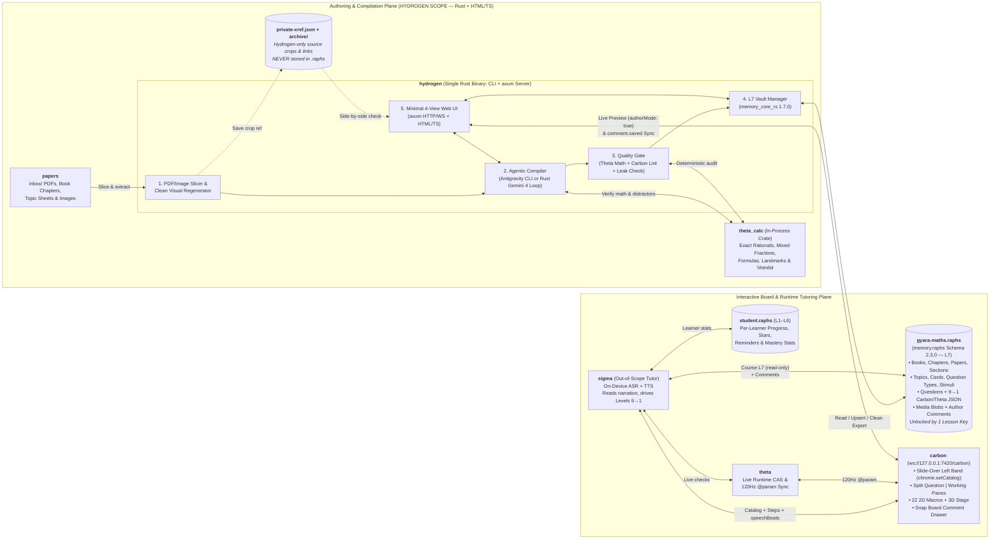
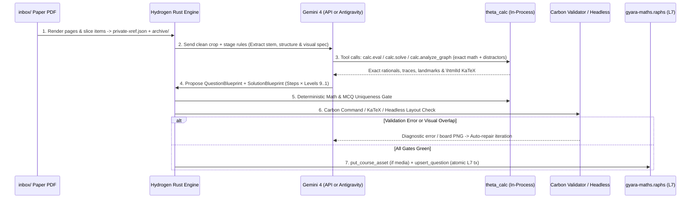

# Hydrogen — System Architecture Specification (`architecture.md`)

> **Status:** Locked Pre-Build Architecture  
> **Scope:** **Hydrogen** — Multi-Product Rust AI Curriculum Compiler, Replica Generator, Comment Processor, CLI & Minimal Authoring Web Console (`axum + HTML/TS`).  
> **Aligned Ecosystem Specifications:**
> - Ecosystem Topology: [`gyara-workflow.png`](./gyara-workflow.png)
> - Product Requirements: [`requirements.md`](./requirements.md)
> - Pedagogical & 9-Level Rules: [`solution-levels.md`](./solution-levels.md)
> - Phased Implementation Plan: [`build-plan.md`](./build-plan.md)
> - Deterministic CAS & Graph VM: [`theta-integration.md`](./theta-integration.md) (`theta_calc`)
> - Interactive 2-Way Whiteboard: [`carbon-integration.md`](./carbon-integration.md) (`Carbon Protocol v0.1`)
> - Encrypted Course Vaults: [`memory-raphs.md`](./memory-raphs.md) (`memory.raphs` Schema `2.3.0` / `memory_core_rs 1.7.0` Layer `L7`)

---

## 1. Architectural Overview & Core Principles

**Hydrogen** is the authoring and compilation engine at the heart of the curriculum ecosystem. It transforms raw educational sources (`papers`: PDF question papers, books/chapters, topic worksheets, images) into encrypted, self-contained **`.raphs` course vaults** (`gyara-maths.raphs`, `gyara-english.raphs`, `gyara-verbal-reasoning.raphs`, `gyara-non-verbal-reasoning.raphs`, `gcse-maths.raphs`, `gcse-physics.raphs`, etc.).

### Five Governing Architectural Principles
1. **Heavy Hydrogen + Theta, Thin SIGMA:** Small on-device tutor models (**SIGMA**) hallucinate if asked to invent multi-step math or 2D/3D whiteboard coordinates. Therefore, **Hydrogen** pre-compiles **all** mathematical derivations (verified in-process via `theta_calc`), **all** 2D/3D **Carbon** scene/macro coordinates, `\htmlId` token anchors, MCQ trap diagnostics, and plain-English narration scripts across **Question-Relative Sub-Levels `9 → 1`**.
2. **Native SQLite Course Layer (`memory.raphs` Schema `2.3.0` `L7`):** Course vaults use native SQLite `course_*` tables (`memory_core_rs 1.7.0`), FTS5 + `vec0` embeddings, and 3-way ref-counted `blobs` unlocked with **one simple Lesson Key**.
3. **Zero Learner State & Zero Source Leakage in `.raphs`:**
   - **No student statistics** live inside `gyara-maths.raphs` (learner progress lives in personal `<student>.raphs` vaults and is merged in memory by SIGMA at runtime).
   - **No raw source PDFs, cropped scans, or external paper names** ever enter `.raphs`; Hydrogen stores private source mappings strictly in local `private-xref.json` for author verification.
4. **Dual Execution Modes Over One Deterministic Core:** Hydrogen exposes the exact same deterministic Rust core (`memory_core_rs` + `theta_calc` + Carbon validator) to **both** **(a) Interactive Antigravity sessions** (via `hydrogen` CLI for rapid 1–2 paper prototyping) and **(b) Native Rust Gemini 4 API Agentic Batch Jobs** (via the `axum` Web UI and scheduled runs).
5. **Live Closed-Loop Testing & Feedback:** Hydrogen's minimal Web UI (`axum + HTML/TS`) connects directly to a live **Carbon** instance (`ws://127.0.0.1:7420/carbon` with `authorMode: true`) to preview the Left-Band Book Index (`chrome.setCatalog`), step through `Level 9 → 1` solutions, capture **`Snap Board`** comments into `course_comments`, and re-compile fixes in place.

---

## 2. End-to-End Ecosystem Topology



---

## 3. Hydrogen Workspace & Internal Rust Module Layout

Hydrogen lives in a clean Rust workspace alongside the `products/` directory hierarchy:

```text
hydrogen/
├── Cargo.toml                              # Rust workspace / package manifest
├── docs/                                   # Specifications & build plan
│   ├── gyara-workflow.png
│   ├── requirements.md
│   ├── architecture.md
│   ├── solution-levels.md
│   ├── build-plan.md
│   ├── theta-integration.md
│   ├── carbon-integration.md
│   └── memory-raphs.md
├── rules/                                  # Strictly product-isolated 4-tier pedagogical & visual rules
│   ├── common.md                           # Tier 1: Global clarity, simplicity, elegance & Carbon/KaTeX hygiene
│   ├── gyaraplus/                          # Tier 2..4: 11+ (common.md + {maths,english,vr,nvr}/{common,levels}.md)
│   ├── gcse/                               # Tier 2..4: GCSE (common.md + {maths,physics}/{common,levels,tier}.md)
│   ├── alevel/                             # Tier 2..4: A-Level (common.md + {maths,physics}/{common,levels}.md)
│   ├── primary/                            # Tier 2..4: Primary KS2
│   └── infant/                             # Tier 2..4: Infant EYFS/KS1
├── products/                               # Multi-product root (TRACKED in Git for assets/logos/docs)
│   ├── gyaraplus/
│   │   ├── assets/                         # GIT-TRACKED brand logos: gyara-{white,blue}.{png,svg}
│   │   ├── inbox/maths/                    # GIT-IGNORED: Drop raw PDFs / images here
│   │   ├── archive/maths/                  # GIT-IGNORED: Processed raw sources + page/question crops
│   │   ├── private-xref.json               # GIT-IGNORED: Private ID <-> source PDF/page/bbox map
│   │   └── gyara-maths.raphs               # GIT-IGNORED: Live L7 course vault (.sqlite/.keys.json or .raphs)
│   └── gcse/
│       ├── assets/
│       ├── maths/
│       └── physics/
├── src/
│   ├── main.rs                             # Unified `hydrogen` binary (CLI subcommands + `serve`)
│   ├── config.rs                           # Env/TOML config (products root, Lesson Keys, Carbon URL, Gemini API)
│   ├── rules/                              # 4-tier RuleLoader (YAML frontmatter + isolated product/subject/level markdown)
│   ├── domain/                             # Strongly-typed QuestionBlueprint, SolutionBlueprint (L9..L1), UniversalId
│   ├── vault/                              # `memory_core_rs 1.7.0` L7 wrapper, catalog projector & clean exporter
│   ├── theta/                              # In-process `theta_calc` wrapper, 11+/GCSE presets & math/MCQ verifier
│   ├── carbon/                             # Carbon WS client (`ws://...:7420/carbon`), Catalog builder, validator & comment listener
│   ├── ingest/                             # PDF page renderer/cropper, `private-xref.json` store & inbox->archive mover
│   ├── compiler/                           # Gemini 4 agentic tool loop, replica generator, topic builder & comment fixer
│   └── server/                             # `axum` REST + WS routes serving `web/` static UI & live job events
└── web/                                    # Minimal zero-bloat HTML + TypeScript + CSS 4-view Hydrogen Console
```

---

## 4. Core Subsystem Designs

### 4.1 L7 Vault Subsystem (`src/vault/` ↔ `memory_core_rs 1.7.0`)
- **Live Working Container vs. Packed `.raphs` Bundle:**
  - While `memory_core_rs` operates on `<dir>/gyara-maths.sqlite` + `gyara-maths.keys.json` during fast incremental SQLite transactions and packs/unpacks single-file `gyara-maths.raphs` zip bundles via `Memory::pack` / `bundle::unpack` / `Memory::export_clean_course_bundle`, Hydrogen's `VaultHandle` manages this transparently behind a `tokio::sync::Mutex<Memory>` (honoring `memory.raphs` Conformance Rule A6: single `Memory` connection per file per process).
- **Embedded Product Brand Logo Blobs & Subject Palette (`course_media_assets` + `course_meta.config_json`):**
  - When initializing or updating a product vault, Hydrogen embeds the product's brand logos from `products/<product>/assets/` into `blobs` via `memory.put_course_asset(...)` (`GYR-LOGO-WHITE` from `gyara-white.png` and `GYR-LOGO-BLUE` from `gyara-blue.png` as the primary 100% font-independent renders, alongside optional `.svg` source assets) and stores `{ "branding": { "logoWhiteAssetId": "GYR-LOGO-WHITE", "logoLightAssetId": "GYR-LOGO-BLUE", "subjectColor": "#2563EB", "importantIcon": "triangle" } }` in `course_meta.config_json`.
  - Both **SIGMA** (in student sessions) and **Hydrogen** (in Author Preview) read `GYR-LOGO-WHITE` out of `blobs` and pass it as a `data:image/png;base64,...` URI in `chrome.setCatalog.params.brandLogo` and `subjects[].logo`.
- **Zero-Overhead Full-Stage & Slide-Over Projection (`CourseCatalogSnapshot` $\to$ Carbon `chrome.setCatalog`):**
  - Calls `memory.course_catalog_snapshot()` (`< 1 ms` indexed scalar read) and maps to Carbon's `chrome.setCatalog` (`displayMode: "full-stage"` or `"slide-over"`, `viewLevel: "subjects" | "subject-root" | "paper-detail" | "topic-detail"`):
    - `course_meta.config_json.branding` + `blobs` $\to$ `brandLogo`, `importantIcon: "triangle"`, and jewel-toned `subjects[]` Hero Cards (`#2563EB` Maths, `#0D9488` English, `#7C3AED` VR, `#DB2777` NVR),
    - `papers` + `paper_sections` + `questions` (`container_kind == "paper"`, tagging `is_replica == true` with violet `AI` `tagBadges` and `filterTags`) $\to$ `chrome.setCatalog.params.papers[]`,
    - `books` $\to$ `chapters` $\to$ `topics` $\to$ `topic_cards` + `questions` $\to$ `chrome.setCatalog.params.topics[]` (`parentId` hierarchy),
    - Author QA metrics (`total questions`, `verified`, `open comments`, `replicas`, `topic breakdown`) $\to$ `chrome.setCatalog.params.stats` when previewing in Hydrogen Author Mode *(while learner `important` `△`, `reminder: "15d"`, and Deep Crimson `#6B1414` `dueReminder: true` states are merged strictly at runtime by SIGMA from `<student>.raphs`)*.

### 4.2 Deterministic Math & Distractor Engine (`src/theta/` ↔ `theta_calc`)
- Calls `theta_calc` directly in Rust (`< 50 µs` per call):
  - **11+ Preset:** `preset: "uk_gcse"`, `angle_mode: "deg"`, `allow_mixed_fractions: true`, `anchor_tokens: true`.
  - **Step & Check Gate:** Evaluates every `thetaVerification` entry inside `solution_json`, asserts exact symbolic/rational equality across `Part (a) -> Part (b)` (`exportedExact`), and verifies `Check ✔` lines.
  - **MCQ Distractor Gate:** For every `mcq` question (`A–E`), verifies all 5 options parse cleanly, are pairwise distinct, and **exactly one** matches `answerKey.exactValue`.

### 4.3 Carbon Live Bridge & Schema Validator (`src/carbon/` ↔ `Carbon Protocol v0.1`)
1. **Static & Headless Validation:**
   - Verifies all math inside `scene.write` is wrapped in `$...$` / `\(...\)` (catching raw ASCII math leaks), all `targetId` / `\htmlId` references resolve in execution order, and canonical Carbon §5.1–§5.2 enums (`warm-paper`, `squared`, `chrome.update`, etc.) are used.
   - Optionally dispatches each `(step, sublevel)` batch to `carbon-shell --headless` and verifies `{ "type": "ack", "ok": true }` (and optional `captureBoard` PNG for VLM layout self-check).
2. **Interactive Live Preview & Comment Sync (`ws://127.0.0.1:7420/carbon`):**
   - Connects to a live Carbon window, sends `chrome.update` (`authorMode: true`, `activeItemId`, `activeStepId`, `authorMeta: { sublevel }`) + `chrome.setCatalog` + Left-Pane question commands + selected `(Step, Level)` Right-Pane commands.
   - Listens continuously to Carbon's outbound WebSocket events:
     - `catalog.itemSelected` $\to$ loads the clicked Question or Topic Card from `gyara-maths.raphs` onto Carbon!
     - `comment.saved` $\to$ decodes base64 `Snap Board` / uploaded attachments into `CommentAttachmentBytes` and calls `memory.upsert_course_comment(...)` immediately!
     - `comment.deleted` $\to$ calls `memory.delete_course_comment(...)`.
     - `catalog.actionRequested` (`"create-replica"`) $\to$ queues a replica job in Hydrogen!

### 4.4 4-Tier Isolated Rule Loader (`src/rules/` ↔ `rules/`)
- Resolves strictly within the target product directory so GCSE, A-Level, 11+, Primary, and Infant rules never bleed across products:
  `rules/common.md` $\to$ `rules/<product>/common.md` $\to$ `rules/<product>/<subject>/common.md` $\to$ `rules/<product>/<subject>/levels.md` *(+ optional tier/class file such as `foundation.md` / `higher.md`)*.
- Parses the YAML frontmatter on `<subject>/common.md` to configure `theta_calc` (`preset`, `angle_mode`, `allow_mixed_fractions`), default `answer_format` (`mcq` vs `written`), and `level_9_policy` (`allowed` / `forbidden` methods), while assembling the exact concatenated rulebook for the AI compiler—dynamically reloadable from disk without recompiling Rust.

### 4.5 Agentic Compilation Pipeline (`src/compiler/`)
Supports **both** execution paths over the exact same JSON contracts and quality gates:



### 4.6 Minimal 4-View Hydrogen Web Console — Light, Soft Card-Grid Theme (`src/server/` + `web/`)
Served by `axum` on `http://127.0.0.1:7430`:
- **Light, Soft Card-Grid Aesthetic + Vault Brand Logo:**
  - Uses a calm, eye-friendly **light, soft theme** (`#F6F7FB` soft porcelain-slate canvas, `#FFFFFF` elevated cards with `#E2E8F0` hairline borders and subtle soft shadows—ideal alongside white PDF source crops and KaTeX working):
  - **Header & Navigation:** Clean light top bar featuring pill breadcrumbs (`[🏠] > [11+ Maths] > [Practice Papers] > [Paper 01]`) on the left and the centered **`Gyara+` light-surface logo (`GYR-LOGO-BLUE` / `gyara-blue.png`)** served directly from the `.raphs` vault `blobs` *(while `GYR-LOGO-WHITE` is used inside jewel-toned Subject Cards and sent to Carbon's dark Full-Stage Gallery)*.
  - **Soft Pastel Multi-State Card Grid:** Preserves the same 3-level card-grid hierarchy (`Subjects` $\to$ `Papers / Topics` $\to$ `Questions`) with soft status tints: `#FFFFFF` (ready/unreviewed), `#EFF6FF` soft sky (compiling/in-progress), `#ECFDF5` soft sage-mint (verified), `#FEF2F2` with `#FECACA` border (needs attention: open `fix` comments or gate errors), and `#EDE9FE`/`#6D28D9` soft violet `AI` replica badges.
- **REST API (`/api/...`):**
  - `GET /api/vaults` & `POST /api/vaults/open` — switch between `gyara-maths.raphs`, `gyara-nvr.raphs`, etc.
  - `GET /api/catalog` — returns `CourseCatalogSnapshot` (Books, Chapters, Papers, Topics, Types, Question Summaries, Comment Counts).
  - `GET /api/questions/:id` & `GET /api/questions/:id/source-crop` — returns full `CourseQuestion` (`question_json`, `solution_json`, `revisions`) and streams the private crop from `private-xref.json` (`archive/`).
  - `POST /api/carbon/preview` — pushes a Question + specific `(part, step, sublevel)` live to Carbon (`ws://127.0.0.1:7420/carbon`).
  - `POST /api/jobs/ingest`, `POST /api/jobs/replica`, `POST /api/jobs/process-comments`, `POST /api/vaults/export-clean` — triggers async jobs.
- **WebSocket (`/api/ws`):** Streams real-time job progress (`question 12/50: Theta verified ✔`) and live `comment.saved` notifications straight to the browser UI.
