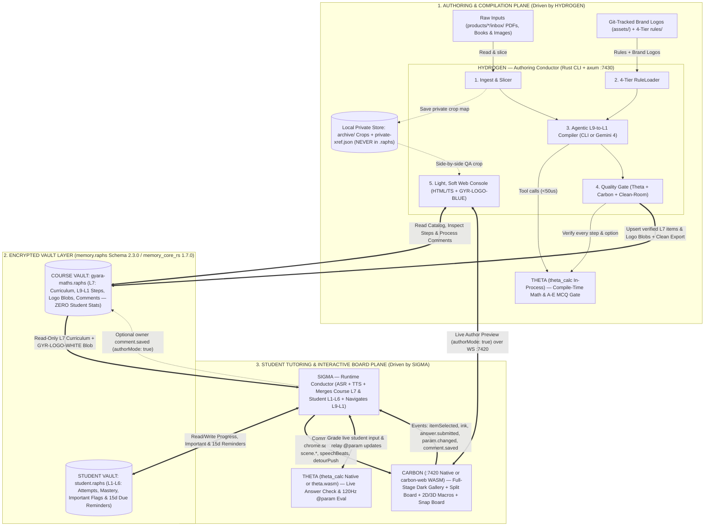
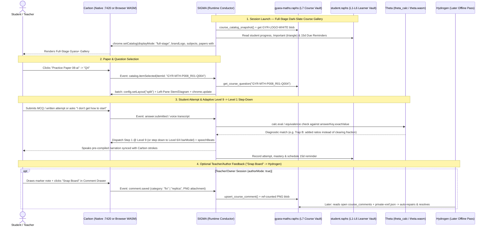
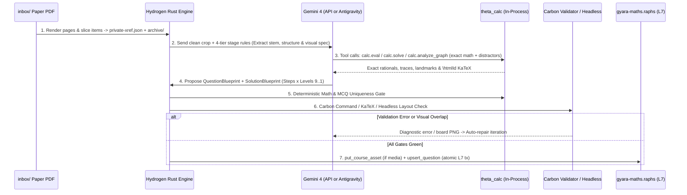

# Ecosystem & Hydrogen System Architecture (`system-architecture.md`)

> **Status:** Locked Cross-Component Master Architecture  
> **Audience:** Engineers & AI Agents working on **Hydrogen**, **SIGMA**, **Carbon**, **Theta**, and **`memory.raphs`** — providing one shared source of truth on **who drives what**, how all five components connect, and where strict boundaries sit.  
> **Aligned Specifications:**
> - Visual Workflow Diagram: [`gyara-workflow.png`](./gyara-workflow.png)
> - Hydrogen Product Requirements: [`requirements.md`](./requirements.md)
> - Pedagogical & 9-Level Solution Rules: [`solution-levels.md`](./solution-levels.md) + [`../rules/README.md`](../rules/README.md)
> - Phased Implementation Plan: [`build-plan.md`](./build-plan.md)
> - Sibling Contracts: [`theta-integration.md`](./theta-integration.md) · [`carbon-integration.md`](./carbon-integration.md) · [`memory-raphs.md`](./memory-raphs.md)

---

## 1. Executive Summary & Five Governing Principles

The curriculum and tutoring platform is composed of **five specialized Rust-first components**—**Hydrogen**, **`memory.raphs`**, **Theta**, **Carbon**, and **SIGMA**—separated cleanly between an **Offline/Authoring Compilation Plane** (driven by **Hydrogen**) and a **Live Student Tutoring Plane** (driven by **SIGMA**, running either as a native desktop/tablet app or zero-install in a web browser via WebAssembly).

### Five Governing Architectural Principles
1. **Strict Single-Conductor Rule ("Who Drives What"):**
   - At **Authoring & Compilation Time**, **Hydrogen** is the **sole active conductor**. It drives `Theta`, `memory.raphs` (`L7`), and `Carbon` (`authorMode: true`).
   - At **Student Runtime**, **SIGMA** is the **sole active conductor**. It opens two `memory.raphs` vaults (`Course L7` read-only + `Student L1–L6` read/write), drives `Carbon` (`authorMode: false` for students), and calls `Theta` for live answer/slider checks.
   - **Carbon**, **Theta**, and **`memory.raphs`** are **never autonomous orchestrators**: they never call LLMs, never invent curriculum policy, and never talk behind the active conductor's back.
2. **Heavy Hydrogen + Theta at Compile Time, Thin SIGMA at Runtime:**
   - Small on-device or low-latency voice models (**SIGMA**) hallucinate if asked to derive multi-step algebra or compute 2D/3D whiteboard coordinates on the fly.
   - Therefore, **Hydrogen** pre-compiles **100% of mathematical derivations** (verified in-process via `theta_calc`), **all 2D/3D Carbon scene/macro coordinates**, `\htmlId` token anchors, MCQ trap diagnostics (`A–E`), brand logo blobs, and plain-English narration scripts across **Question-Relative Sub-Levels `9 → 1`**.
3. **Two Strictly Separated `memory.raphs` Vault Roles (`Course L7` vs. `Student L1–L6`):**
   - **`<product>-<subject>.raphs` (`Schema 2.3.0` Layer `L7`, e.g., `gyara-maths.raphs`):** Pure curriculum, brand logos, media blobs, `9 → 1` solutions, and (during authoring) `course_comments`. Unlocked with **one simple Lesson Key**. **Contains ZERO student statistics.**
   - **`<student>.raphs` (Layers `L1–L6`):** Personal per-learner vault storing attempts, scores, mastery, `important` (`△`) flags, `15d` spaced-repetition reminders, and `dueReminder` states. Merged in memory by **SIGMA** right before sending `chrome.setCatalog` to **Carbon**.
4. **Zero Source Paper Leakage:**
   - Raw source PDFs (`inbox/`), cropped page scans (`archive/`), and external school/publisher paper names **never** enter `<product>-<subject>.raphs`. Only Hydrogen's local Git-ignored `private-xref.json` maps `GYR-MTH-P001-Q014` back to its source PDF crop for author QA.
5. **Single Rust Codebase Supporting Both Native Apps & Zero-Install Web Browsers:**
   - Because **Carbon** (`StageRuntime` $\to$ `engine.wasm`) and **Theta** (`theta_calc` $\to$ `theta.wasm`) are pure Rust, the **exact same `main` branches** support both **(a) Native Local Apps** (`carbon-shell` + local `SIGMA` + local `.raphs`) and **(b) Zero-Install Web Browsers** (`carbon-web` WASM + `theta.wasm` in Chrome/Safari/iPad talking over `wss://` to a server-side `SIGMA` + `.raphs` gateway).

---

## 2. The Five Ecosystem Components: Roles, Pins & Strict Boundaries

| Component | Role Type | Repository / Crate Pin | Default Port | What It Owns | What It MUST NEVER Do |
| :--- | :--- | :--- | :---: | :--- | :--- |
| **`Hydrogen`** *(This Repo)* | **Authoring Conductor** (`CLI` + `axum` Server + Light-Soft Web UI) | `git@github.com:raphsaeed/hydrogen.git` (`main`) | `:7430` (HTTP + WS) | PDF/image slicing, 4-tier `rules/` loading, Gemini 4 + Antigravity `L9→L1` compilation, Theta verification gate, replica & topic generation, comment processing, live Carbon author preview, and `.raphs` packaging/clean export. | Never runs during student lessons; never stores student stats in `<product>-<subject>.raphs`; never leaks raw PDF scans/names into `.raphs`; never modifies sibling repos. |
| **`memory.raphs`** (`memory_core_rs`) | **Embedded Encrypted Vault Engine** (Library Crate) | `ssh://git@github.com/raphs-app/raphs.git` (`tag = "memory-core-1.7.0"`, Schema `2.3.0`) | *In-process library* | SQLCipher `4.14` encryption, `L7` `course_*` tables, `L1–L6` learner memory tables, FTS5 + `vec0` RRF search, 3-way ref-counted `blobs`, `< 1 ms` `course_catalog_snapshot()`, and `export_clean_course_bundle()`. | Never opens network ports, never renders UI, and never executes math or LLM calls. Enforces 1 `Memory` handle per vault file per process (Rule A6). |
| **`Theta`** (`theta_calc`) | **Deterministic CAS & Graph VM** (Library Crate + `.wasm`) | `/home/raphspark/projects/theta/crates/calc-api` (`package = "calc-api"`, crate `theta_calc`) | *In-process library* / `.wasm` | Exact rational/symbolic arithmetic, mixed fractions, equation solving, 313-formula registry (`FIFA`), stats working, 120 FPS Graph VM landmarks, and `\htmlId` KaTeX token emission (`< 50 µs`). | Stateless pure computation: never opens `.raphs` vaults, never calls LLMs, and never initiates network connections on its own. |
| **`Carbon`** (`carbon-shell` & `carbon-web`) | **120Hz Interactive Whiteboard & Gallery Stage** (Native + WASM) | `ssh://git@github.com/raphsaeed/carbon.git` (`carbon-protocol` crate on `main`) | `:7420` (`:7421` Studio) | Full-Stage Dark-Slate Course Gallery (`displayMode: "full-stage"`), Slide-Over Index, Split `Question \| Working` panes, KaTeX + handwritten strokes, 22 2D macros, 3D math stage, stylus ink/rubber, and `Snap Board` Comment Drawer. | Pure rendering stage & input emitter: **never** opens `.raphs` vaults directly, **never** calls LLMs, and **never** owns student persistence or curriculum rules. |
| **`SIGMA`** | **Runtime Tutoring Conductor** (Voice + Adaptive Navigator) | *Separate Runtime Repo* (links `memory_core_rs`, `theta_calc`, `carbon-protocol`) | *Client / `wss://` Gateway* | Student ASR (listen) + TTS (speak + `speechBeats`), merging `Course L7` + `Student L1–L6` for Carbon's Gallery, stepping `Level 9 ↔ Level 1` or `flow.detourPush` Topic Cards, live answer grading via `Theta`, and saving student stats/reminders. | Never invents multi-step algebra or raw board coordinates from scratch (relies on Hydrogen's pre-compiled `9 → 1` steps); never mutates curriculum tables in `<product>-<subject>.raphs`. |

---

## 3. Master System Topology: Who Drives What & How Every Piece Connects

### 3.1 Full Ecosystem Architecture Diagram (Authoring Plane, Vault Bridge & Runtime Planes)



---

### 3.2 Component-to-Component Connection & Control Matrix

Every connection in the ecosystem has an explicit **Driver (Caller)**, **Target (Callee)**, **Transport**, and **Contract**:

| # | Driver (Initiator) | Target | Transport / Binding | When Active | Exact Payloads & Responsibility |
| :-: | :--- | :--- | :--- | :--- | :--- |
| **1** | **Hydrogen** | **`Theta` (`theta_calc`)** | In-process Rust crate (`calc-api`) | Authoring / Compile | Calls `calc.eval`, `calc.solve`, `calc.formula`, `calc.stats`, `calc.analyze_graph` (`< 50 µs`) to compute exact rationals, mixed fractions, `\htmlId` KaTeX tokens, graph landmarks, and verify all 5 `A–E` MCQ distractors. |
| **2** | **Hydrogen** | **`Course .raphs` (`memory_core_rs`)** | In-process Rust crate (`SQLCipher L7`) | Authoring / Export | Writes `course_meta` (including `GYR-LOGO-WHITE` & `GYR-LOGO-BLUE` brand blobs), papers, sections, books/chapters, topics, stimuli, questions (`question_json` + `solution_json`), processes/resolves `course_comments`, and runs `export_clean_course_bundle()`. |
| **3** | **Hydrogen** *(Web UI or CLI)* | **`Carbon`** (`carbon-shell` / `carbon-web`) | WebSocket (`ws://127.0.0.1:7420/carbon` on Mac or `ws://<mac-ip>:7420/carbon` over LAN) | Authoring Live Preview | Hydrogen sends `chrome.update` (`authorMode: true`), `chrome.setCatalog` (`displayMode: "full-stage"`), Left-Pane question batch, and Right-Pane `(Step, Level)` batch. Carbon emits back `catalog.itemSelected`, `comment.saved` (with base64 `Snap Board` PNGs $\to$ saved into `course_comments`), and `catalog.actionRequested` (`"create-replica"`). |
| **4** | **SIGMA** | **`Course .raphs` (`memory_core_rs`)** | In-process Rust crate (`SQLCipher L7`) | Student Runtime | Opens `<product>-<subject>.raphs` using the single **Lesson Key** (`open_with_passphrase`). Calls `course_catalog_snapshot()` (`< 1 ms`), reads `GYR-LOGO-WHITE` blob, loads `CourseQuestion` (`L9..L1` steps + `narration`) and linked `CourseTopicCard`s. *(Writes nothing except optional `course_comments` if teacher/owner `authorMode: true` is enabled.)* |
| **5** | **SIGMA** | **`Student .raphs` (`memory_core_rs`)** | In-process Rust crate (`SQLCipher L1–L6`) | Student Runtime | Reads and updates per-student question state (`default` / `in-progress` / `completed`), attempt/correct counts, `important: true` (`△`), spaced-repetition `reminder` (`"15d"`), and `dueReminder: true` (`repeat due`). |
| **6** | **SIGMA** | **`Carbon`** (`carbon-shell` or `carbon-web`) | WebSocket (`ws://127.0.0.1:7420/carbon` locally or `wss://` in Browser Mode) | Student Runtime | **SIGMA drives every visual transition on Carbon:** merges `Course L7` + `Student L1–L6` into `chrome.setCatalog` (`displayMode: "full-stage"`, `brandLogo`, `importantIcon: "triangle"`, 4-state card colors including `#6B1414` Deep Crimson `dueReminder`); upon `catalog.itemSelected`, switches Carbon to Split Whiteboard and streams Hydrogen's pre-compiled `batch` commands + `speechBeats` across `Level 9 ↔ Level 1`. |
| **7** | **SIGMA** *(or Browser WASM Host)* | **`Theta`** (`theta_calc` or `theta.wasm`) | In-process Rust crate (Native/Server) or WASM call (Browser) | Student Runtime | Evaluates student free-form math answers for equivalence against `answerKey.exactValue` and computes 120Hz `@param` reactive expressions (`Carbon param.changed` $\to$ `Theta` $\to$ `Carbon reactive.setParams`). |

---

### 3.3 End-to-End Runtime Sequence: Student Session & Teaching Feedback Loop

This sequence shows how **SIGMA**, **`Course .raphs`**, **`Student .raphs`**, **Carbon**, **Theta**, and **Hydrogen** cooperate during a real lesson:



---

### 3.4 Three Operating Deployment Topologies (Same Core Crates, Zero Forked Branches)

1. **Cross-Machine Authoring Topology (Founder Workflow — Mac + DGX Spark):**
   - **DGX Spark (`Linux`):** Runs `hydrogen serve` (`:7430`), linking `memory_core_rs 1.7.0`, `theta_calc`, and `carbon-protocol`, reading/writing `gyara-maths.raphs`.
   - **Mac:** Runs native `carbon-shell --split` (`:7420`) and opens Hydrogen's Light, Soft Web Console (`http://<dgx-ip>:7430`) in Safari/Chrome. The browser (or Hydrogen backend via `--lan`) bridges directly to `ws://127.0.0.1:7420/carbon` for live `Level 9 → 1` preview and `Snap Board` comment capture.
2. **Native Offline Student / Classroom Topology:**
   - A single local app bundle runs **SIGMA** + `memory_core_rs` (local `gyara-maths.raphs` + `<student>.raphs`) + `theta_calc` + `carbon-shell` (`ws://127.0.0.1:7420/carbon`)—100% offline with zero cloud latency or recurring server cost.
3. **Zero-Install Web Browser Topology (Phase 8 — Individual B2C Users on Any Device):**
   - **In the Student's Browser (iPad, Chromebook, Windows, Mac):** Static **`carbon-web` (`engine.wasm`) + `theta.wasm`** built from `main` render the 120Hz Full-Stage Gallery, whiteboard macros, 3D stage, and sliders locally on the client GPU.
   - **On the Cloud Server (`axum` + `SIGMA`):** Keeps `<product>-<subject>.raphs` strictly server-side (preventing `.raphs` file piracy), authenticates the user, syncs `<student>.raphs` progress/reminders across devices, and streams only the active question/step Carbon JSON over `wss://`.

---

## 4. Hydrogen Workspace & Internal Rust Module Layout

Within this repository (`/home/raphspark/projects/hydrogen`), Hydrogen is organized as a single unified Rust crate (`CLI` + `axum` server) alongside Git-tracked `rules/` and `products/` brand assets:

```text
hydrogen/
├── Cargo.toml                              # Rust package manifest (links memory_core_rs, theta_calc, carbon-protocol)
├── docs/                                   # Ecosystem & Hydrogen specifications
│   ├── gyara-workflow.png
│   ├── requirements.md
│   ├── system-architecture.md              # <--- This master ecosystem & Hydrogen architecture doc
│   ├── solution-levels.md
│   ├── build-plan.md
│   ├── theta-integration.md
│   ├── carbon-integration.md
│   └── memory-raphs.md
├── rules/                                  # Strictly product-isolated 4-tier pedagogical & visual rules
│   ├── common.md                           # Tier 1: Global clarity, simplicity, elegance & Carbon/KaTeX hygiene
│   ├── gyaraplus/                          # Tier 2..4: 11+ (common.md + {maths,english,vr,nvr}/{common,levels}.md)
│   ├── gcse/                               # Tier 2..4: GCSE (common.md + {maths,physics}/{common,levels,tier}.md)
│   ├── alevel/                             # Tier 2..4: A-Level (common.md + {maths,physics}/{common,levels}.md)
│   ├── primary/                            # Tier 2..4: Primary KS2
│   └── infant/                             # Tier 2..4: Infant EYFS/KS1
├── products/                               # Multi-product root (TRACKED in Git for assets/logos/docs)
│   ├── gyaraplus/
│   │   ├── assets/                         # GIT-TRACKED brand logos: gyara-{white,blue}.{png,svg}
│   │   ├── inbox/maths/                    # GIT-IGNORED: Drop raw PDFs / images here
│   │   ├── archive/maths/                  # GIT-IGNORED: Processed raw sources + page/question crops
│   │   ├── private-xref.json               # GIT-IGNORED: Private ID <-> source PDF/page/bbox map
│   │   └── gyara-maths.raphs               # GIT-IGNORED: Live L7 course vault (.sqlite/.keys.json or .raphs)
│   └── gcse/
│       ├── assets/
│       ├── maths/
│       └── physics/
├── src/
│   ├── main.rs                             # Unified `hydrogen` binary (CLI subcommands + `serve`)
│   ├── config.rs                           # Env/TOML config (products root, Lesson Keys, Carbon URL, Gemini API)
│   ├── rules/                              # 4-tier RuleLoader (YAML frontmatter + isolated product/subject/level markdown)
│   ├── domain/                             # Strongly-typed QuestionBlueprint, SolutionBlueprint (L9..L1), UniversalId
│   ├── vault/                              # `memory_core_rs 1.7.0` L7 wrapper, logo seeder, catalog projector & clean exporter
│   ├── theta/                              # In-process `theta_calc` wrapper, 11+/GCSE presets & math/MCQ verifier
│   ├── carbon/                             # Carbon WS client (`ws://...:7420/carbon`), Catalog builder, validator & comment listener
│   ├── ingest/                             # PDF page renderer/cropper, `private-xref.json` store & inbox->archive mover
│   ├── compiler/                           # Gemini 4 agentic tool loop, replica generator, topic builder & comment fixer
│   └── server/                             # `axum` REST + WS routes serving `web/` static UI & live job events
└── web/                                    # Minimal zero-bloat Light, Soft HTML + TypeScript + CSS 4-view Console
```

---

## 5. Hydrogen Internal Subsystem Designs

### 5.1 L7 Vault Subsystem (`src/vault/` ↔ `memory_core_rs 1.7.0`)
- **Live Working Container vs. Packed `.raphs` Bundle:**
  - `memory_core_rs` operates on `<dir>/gyara-maths.sqlite` + `gyara-maths.keys.json` during fast incremental SQLite transactions and packs/unpacks single-file `gyara-maths.raphs` zip bundles via `Memory::pack` / `bundle::unpack` / `Memory::export_clean_course_bundle`. Hydrogen's `VaultHandle` wraps this behind a `tokio::sync::Mutex<Memory>` (honoring `memory.raphs` Conformance Rule A6: single `Memory` connection per file per process).
- **Embedded Product Brand Logo Blobs & Subject Palette (`course_media_assets` + `course_meta.config_json`):**
  - When initializing or updating a product vault, Hydrogen embeds the product's brand logos from `products/<product>/assets/` into `blobs` via `memory.put_course_asset(...)` (`GYR-LOGO-WHITE` from `gyara-white.png` and `GYR-LOGO-BLUE` from `gyara-blue.png` as 100% font-independent PNG renders, alongside optional `.svg` source assets) and stores `{ "branding": { "logoWhiteAssetId": "GYR-LOGO-WHITE", "logoLightAssetId": "GYR-LOGO-BLUE", "subjectColor": "#2563EB", "importantIcon": "triangle" } }` in `course_meta.config_json`.
  - **SIGMA** and **Hydrogen** pass `GYR-LOGO-WHITE` (`data:image/png;base64,...`) to Carbon's dark Full-Stage Gallery (`brandLogo` + `subjects[].logo`), while Hydrogen's own Light, Soft Web Console renders `GYR-LOGO-BLUE` in its top bar.
- **Zero-Overhead Full-Stage & Slide-Over Projection (`CourseCatalogSnapshot` $\to$ Carbon `chrome.setCatalog`):**
  - Calls `memory.course_catalog_snapshot()` (`< 1 ms` indexed scalar read) and maps to Carbon's `chrome.setCatalog` (`displayMode: "full-stage"` or `"slide-over"`, `viewLevel: "subjects" | "subject-root" | "paper-detail" | "topic-detail"`):
    - `course_meta.config_json.branding` + `blobs` $\to$ `brandLogo`, `importantIcon: "triangle"`, and jewel-toned `subjects[]` Hero Cards (`#2563EB` Maths, `#0D9488` English, `#7C3AED` VR, `#DB2777` NVR),
    - `papers` + `paper_sections` + `questions` (`container_kind == "paper"`, tagging `is_replica == true` with violet `AI` `tagBadges` and `filterTags`) $\to$ `chrome.setCatalog.params.papers[]`,
    - `books` $\to$ `chapters` $\to$ `topics` $\to$ `topic_cards` + `questions` $\to$ `chrome.setCatalog.params.topics[]` (`parentId` hierarchy),
    - Author QA metrics (`total questions`, `verified`, `open comments`, `replicas`, `topic breakdown`) $\to$ `chrome.setCatalog.params.stats` when previewing in Hydrogen Author Mode *(while learner `important` `△`, `reminder: "15d"`, and Deep Crimson `#6B1414` `dueReminder: true` states are merged strictly at runtime by SIGMA from `<student>.raphs`)*.

### 5.2 Deterministic Math & Distractor Engine (`src/theta/` ↔ `theta_calc`)
- Calls `theta_calc` directly in Rust (`< 50 µs` per call):
  - **11+ Preset:** `preset: "uk_gcse"`, `angle_mode: "deg"`, `allow_mixed_fractions: true`, `anchor_tokens: true`.
  - **Step & Check Gate:** Evaluates every `thetaVerification` entry inside `solution_json`, asserts exact symbolic/rational equality across `Part (a) -> Part (b)` (`exportedExact`), and verifies `Check ✔` lines.
  - **MCQ Distractor Gate:** For every `mcq` question (`A–E`), verifies all 5 options parse cleanly, are pairwise distinct, and **exactly one** matches `answerKey.exactValue`.

### 5.3 Carbon Live Bridge & Schema Validator (`src/carbon/` ↔ `Carbon Protocol v0.1`)
1. **Static & Headless Validation:**
   - Compile-time type safety via the pure-Rust `carbon-protocol` crate (`serde` + `serde_json`, zero GPU/OS dependencies).
   - Verifies all math inside `scene.write` is wrapped in `$...$` / `\(...\)` (catching raw ASCII math leaks), all `targetId` / `\htmlId` references resolve in execution order, and canonical Carbon §5.1–§5.2 enums (`warm-paper`, `squared`, `chrome.update`, etc.) are used.
   - Optionally dispatches each `(step, sublevel)` batch to `carbon-shell --headless` and verifies `{ "type": "ack", "ok": true }` (and optional `captureBoard` PNG for VLM layout self-check).
2. **Interactive Live Preview & Comment Sync (`ws://127.0.0.1:7420/carbon` or LAN `ws://<mac-ip>:7420/carbon`):**
   - Connects to a live Carbon window (either browser-direct from Mac localhost `:7420` or over LAN from DGX Spark), sends `chrome.update` (`authorMode: true`, `activeItemId`, `activeStepId`, `authorMeta: { sublevel }`) + `chrome.setCatalog` + Left-Pane question commands + selected `(Step, Level)` Right-Pane commands.
   - Listens continuously to Carbon's outbound WebSocket events:
     - `catalog.itemSelected` $\to$ loads the clicked Question or Topic Card from `gyara-maths.raphs` onto Carbon.
     - `comment.saved` $\to$ decodes base64 `Snap Board` / uploaded attachments into `CommentAttachmentBytes` and calls `memory.upsert_course_comment(...)` immediately.
     - `comment.deleted` $\to$ calls `memory.delete_course_comment(...)`.
     - `catalog.actionRequested` (`"create-replica"`) $\to$ queues a replica job in Hydrogen.

### 5.4 4-Tier Isolated Rule Loader (`src/rules/` ↔ `rules/`)
- Resolves strictly within the target product directory so GCSE, A-Level, 11+, Primary, and Infant rules never bleed across products:
  `rules/common.md` $\to$ `rules/<product>/common.md` $\to$ `rules/<product>/<subject>/common.md` $\to$ `rules/<product>/<subject>/levels.md` *(+ optional tier/class file such as `foundation.md` / `higher.md`)*.
- Parses the YAML frontmatter on `<subject>/common.md` to configure `theta_calc` (`preset`, `angle_mode`, `allow_mixed_fractions`), default `answer_format` (`mcq` vs `written`), and `level_9_policy` (`allowed` / `forbidden` methods), while assembling the exact concatenated rulebook for the AI compiler—dynamically reloadable from disk without recompiling Rust.

### 5.5 Agentic Compilation Pipeline (`src/compiler/`)
Supports **both** interactive Antigravity CLI authoring and autonomous Rust Gemini 4 batch authoring over the exact same JSON contracts and quality gates:



### 5.6 Minimal 4-View Hydrogen Web Console — Light, Soft Card-Grid Theme (`src/server/` + `web/`)
Served by `axum` on `http://127.0.0.1:7430`:
- **Light, Soft Card-Grid Aesthetic + Vault Brand Logo:**
  - Uses a calm, eye-friendly **light, soft theme** (`#F6F7FB` soft porcelain-slate canvas, `#FFFFFF` elevated cards with `#E2E8F0` hairline borders and subtle soft shadows—ideal alongside white PDF source crops and KaTeX working):
  - **Header & Navigation:** Clean light top bar featuring pill breadcrumbs (`[🏠] > [11+ Maths] > [Practice Papers] > [Paper 01]`) on the left and the centered **`Gyara+` light-surface logo (`GYR-LOGO-BLUE` / `gyara-blue.png`)** served directly from the `.raphs` vault `blobs` *(while `GYR-LOGO-WHITE` is used inside jewel-toned Subject Cards and sent to Carbon's dark Full-Stage Gallery)*.
  - **Soft Pastel Multi-State Card Grid:** Preserves the same 3-level card-grid hierarchy (`Subjects` $\to$ `Papers / Topics` $\to$ `Questions`) with soft status tints: `#FFFFFF` (ready/unreviewed), `#EFF6FF` soft sky (compiling/in-progress), `#ECFDF5` soft sage-mint (verified), `#FEF2F2` with `#FECACA` border (needs attention: open `fix` comments or gate errors), and `#EDE9FE`/`#6D28D9` soft violet `AI` replica badges.
- **REST API (`/api/...`):**
  - `GET /api/vaults` & `POST /api/vaults/open` — switch between `gyara-maths.raphs`, `gyara-nvr.raphs`, etc.
  - `GET /api/catalog` — returns `CourseCatalogSnapshot` (Books, Chapters, Papers, Topics, Types, Question Summaries, Comment Counts).
  - `GET /api/questions/:id` & `GET /api/questions/:id/source-crop` — returns full `CourseQuestion` (`question_json`, `solution_json`, `revisions`) and streams the private crop from `private-xref.json` (`archive/`).
  - `POST /api/carbon/preview` — pushes a Question + specific `(part, step, sublevel)` live to Carbon (`ws://127.0.0.1:7420/carbon`).
  - `POST /api/jobs/ingest`, `POST /api/jobs/replica`, `POST /api/jobs/process-comments`, `POST /api/vaults/export-clean` — triggers async jobs.
- **WebSocket (`/api/ws`):** Streams real-time job progress (`question 12/50: Theta verified ✔`) and live `comment.saved` notifications straight to the browser UI.
