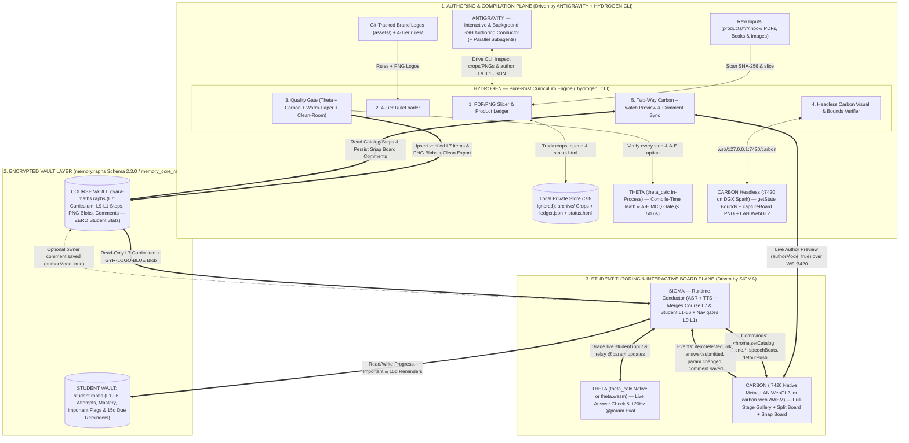
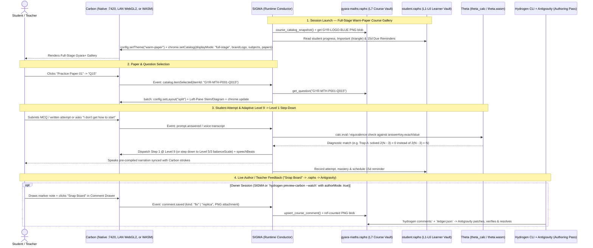

# Ecosystem & Hydrogen System Architecture (`system-architecture.md`)

> **Status:** Locked Cross-Component Master Architecture  
> **Audience:** Engineers & AI Agents working on **Hydrogen**, **SIGMA**, **Carbon**, **Theta**, and **`memory.raphs`** — providing one shared source of truth on **who drives what**, how all five components connect, and where strict boundaries sit.  
> **Aligned Specifications:**
> - Standard Operating Procedure & Commands: [`sop.md`](./sop.md)
> - Visual Workflow Diagram: [`gyara-workflow.png`](./gyara-workflow.png)
> - Hydrogen Product Requirements: [`requirements.md`](./requirements.md)
> - Pedagogical & 9-Level Solution Rules: [`solution-levels.md`](./solution-levels.md) + [`../rules/README.md`](../rules/README.md)
> - Phased Implementation Plan: [`build-plan.md`](./build-plan.md)
> - Sibling Contracts: [`carbon-visual-theme.md`](./carbon-visual-theme.md) · [`theta-integration.md`](./theta-integration.md) · [`carbon-integration.md`](./carbon-integration.md) · [`memory-raphs.md`](./memory-raphs.md)

---

## 1. Executive Summary & Five Governing Principles

The curriculum and tutoring platform is composed of **five specialized Rust-first components**—**Hydrogen**, **`memory.raphs`**, **Theta**, **Carbon**, and **SIGMA**—separated cleanly between an **Offline/Authoring Compilation Plane** (driven by **Hydrogen** + **Antigravity**) and a **Live Student Tutoring Plane** (driven by **SIGMA**, running either as a native desktop/tablet app or zero-install in a web browser via WebAssembly).

### Five Governing Architectural Principles
1. **Strict Single-Conductor Rule ("Who Drives What"):**
   - At **Authoring & Compilation Time**, **Hydrogen** (orchestrated via **Antigravity** over SSH) is the **sole active conductor**. It drives `Theta`, `memory.raphs` (`L7`), and `Carbon` (`authorMode: true`).
   - At **Student Runtime**, **SIGMA** is the **sole active conductor**. It opens two `memory.raphs` vaults (`Course L7` read-only + `Student L1–L6` read/write), drives `Carbon` (`authorMode: false` for students), and calls `Theta` for live answer/slider checks.
   - **Carbon**, **Theta**, and **`memory.raphs`** are **never autonomous orchestrators**: they never call LLMs, never invent curriculum policy, and never talk behind the active conductor's back.
2. **Heavy Hydrogen + Theta at Compile Time, Thin SIGMA at Runtime:**
   - Small on-device or low-latency voice models (**SIGMA**) hallucinate if asked to derive multi-step algebra or compute 2D/3D whiteboard coordinates on the fly.
   - Therefore, **Hydrogen** pre-compiles **100% of mathematical derivations** (verified in-process via `theta_calc`), **all 2D/3D Carbon scene/macro coordinates** (verified against headless `Carbon` bounds & PNG captures), `\htmlId` token anchors, MCQ trap diagnostics (`A–E`), brand logo & media blobs, and plain-English narration scripts across **Question-Relative Sub-Levels `9 → 1`**.
3. **Two Strictly Separated `memory.raphs` Vault Roles (`Course L7` vs. `Student L1–L6`):**
   - **`<product>-<subject>.raphs` (`Schema 2.3.0` Layer `L7`, e.g., `gyara-maths.raphs`):** Pure curriculum, brand logos, media blobs, `9 → 1` solutions, and (during authoring) `course_comments` + `course_question_revisions`. Unlocked with **one simple Lesson Key**. **Contains ZERO student statistics.**
   - **`<student>.raphs` (Layers `L1–L6`):** Personal per-learner vault storing attempts, scores, mastery, `important` (`△`) flags, `15d` spaced-repetition reminders, and `dueReminder` states. Merged in memory by **SIGMA** right before sending `chrome.setCatalog` to **Carbon**.
4. **Zero Source Paper Leakage & Sub-Product Isolation (`products/<product>/<subject>/`):**
   - Shared brand logos live once at `products/<product>/assets/`, while each worked subject (`products/<product>/<subject>/`) is an isolated sub-product holding its own `inbox/`, `archive/`, unified `ledger.json`, `status.html`, and `<stem>.{sqlite,raphs}`. Untouched subjects never clutter `ledger.json` or `status.html`, and raw PDFs/crops/filenames **never** enter `<stem>.raphs` or Git.
5. **Single Rust Codebase Supporting Both Native Apps & Zero-Install Web Browsers:**
   - Because **Carbon** (`StageRuntime` $\to$ `engine.wasm`) and **Theta** (`theta_calc` $\to$ `theta.wasm`) are pure Rust, the **exact same `main` branches** support both **(a) Native Local Apps** (`carbon-shell` + local `SIGMA` + local `.raphs`) and **(b) Zero-Install Web Browsers** (`carbon-web` WASM + `theta.wasm` in Chrome/Safari/iPad talking over `wss://` to a server-side `SIGMA` + `.raphs` gateway).

---

## 2. The Five Ecosystem Components: Roles, Pins & Strict Boundaries

| Component | Role Type | Repository / Crate Pin | Default Port / Binding | What It Owns | What It MUST NEVER Do |
| :--- | :--- | :--- | :---: | :--- | :--- |
| **`Hydrogen`** *(This Repo)* | **Authoring Conductor & Vault CLI** (Pure-Rust CLI + Product Ledger + Static `status.html`) | `/home/raphspark/projects/hydrogen`<br>`git@github.com:raphsaeed/hydrogen.git` (`main`) | CLI + outbound WS to Carbon `:7420` | PDF/image slicing, product authoring ledger (`ledger.json` + `status.html`), 4-tier `rules/` loading, `L9→L1` blueprint & quality gate (`Theta` + headless `Carbon` `captureBoard`), two-way Carbon `--watch` preview & `Snap Board` comment sync, replica/topic scaffolding, and `.raphs` packaging/clean export. | Never runs during student lessons; never stores student stats in `<product>-<subject>.raphs`; never leaks raw PDF scans/names into `.raphs` or Git; **never modifies sibling repos**. |
| **`memory.raphs`** (`memory_core_rs`) | **Embedded Encrypted Vault Engine** (Library Crate) | `ssh://git@github.com/raphs-app/raphs.git` (`tag = "memory-core-1.7.0"`, Schema `2.3.0`) | *In-process library* | SQLCipher `4.14` encryption, `L7` `course_*` tables, `L1–L6` learner memory tables, FTS5 + `vec0` RRF search, 3-way ref-counted `blobs`, `< 1 ms` `course_catalog_snapshot()`, and `export_clean_course_bundle()`. | Never opens network ports, never renders UI, and never executes math or LLM calls. Enforces 1 `Memory` handle per vault file per process (Rule A6). |
| **`Theta`** (`theta_calc`) | **Deterministic CAS & Graph VM** (Library Crate + `.wasm`) | `/home/raphspark/projects/theta/crates/calc-api` (`package = "calc-api"`, crate `theta_calc`) | *In-process library* / `.wasm` | Exact rational/symbolic arithmetic, mixed fractions, equation solving, 313-formula registry (`FIFA`), stats working, 120 FPS Graph VM landmarks, and `\htmlId` KaTeX token emission (`< 50 µs`). | **Read-only sibling.** Stateless pure computation: never opens `.raphs` vaults, never calls LLMs, and never initiates network connections. |
| **`Carbon`** (`carbon-shell` & `carbon-web`) | **120Hz Interactive Whiteboard & Gallery Stage** (Native, Headless & WASM) | `/home/raphspark/projects/carbon` *(prebuilt)*<br>`ssh://git@github.com/raphsaeed/carbon.git` (`carbon-protocol` on `main`) | `:7420` (`/carbon`, `/health`, `/` WebGL2) | Full-Stage Warm-Paper Course Gallery (`displayMode: "full-stage"`), Slide-Over Index, Split `Question \| Working` panes, 5 Curated Font Voices + `PennstanderMath`, 22 2D macros, 3D math stage, stylus ink/rubber, deterministic `captureBoard` PNGs, and `Snap Board` Comment Drawer. | **Read-only sibling.** Pure rendering stage & input emitter: **never** opens `.raphs` vaults directly, **never** calls LLMs, and **never** owns student persistence or curriculum rules. |
| **`SIGMA`** | **Runtime Tutoring Conductor** (Voice + Adaptive Navigator) | *Separate Runtime Repo* (links `memory_core_rs`, `theta_calc`, `carbon-protocol`) | *Client / `wss://` Gateway* | Student ASR (listen) + TTS (speak + `speechBeats`), merging `Course L7` + `Student L1–L6` for Carbon's Gallery, stepping `Level 9 ↔ Level 1` or `flow.detourPush` Topic Cards, live answer grading via `Theta`, and saving student stats/reminders. | Never invents multi-step algebra or raw board coordinates from scratch (relies on Hydrogen's pre-compiled `9 → 1` steps); never mutates curriculum tables in `<product>-<subject>.raphs`. |

---

## 3. Master System Topology: Who Drives What & How Every Piece Connects

### 3.1 Full Ecosystem Architecture Diagram (Authoring Plane, Vault Bridge & Runtime Planes)



---

### 3.2 Component-to-Component Connection & Control Matrix

Every connection in the ecosystem has an explicit **Driver (Caller)**, **Target (Callee)**, **Transport**, and **Contract**:

| # | Driver (Initiator) | Target | Transport / Binding | When Active | Exact Payloads & Responsibility |
| :-: | :--- | :--- | :--- | :--- | :--- |
| **1** | **Hydrogen CLI** | **`Theta` (`theta_calc`)** | In-process Rust crate (`calc-api`) | Authoring / Compile | Calls `calc.eval`, `calc.solve`, `calc.formula`, `calc.transform`, `calc.stats`, `calc.analyze_graph` (`< 50 µs`) to compute exact rationals, mixed fractions, `\htmlId` KaTeX tokens, graph landmarks, and verify all 5 `A–E` MCQ distractors. |
| **2** | **Hydrogen CLI** | **`Course .raphs` (`memory_core_rs`)** | In-process Rust crate (`SQLCipher L7`) | Authoring / Export | Writes `course_meta` (including `GYR-LOGO-BLUE` & `GYR-LOGO-WHITE` PNG blobs), papers, sections, books/chapters, topics, cards, stimuli, questions (`question_json` + `solution_json`), persists/resolves `course_comments`, and runs `export_clean_course_bundle()`. |
| **3** | **Hydrogen CLI** *(`capture-carbon` & `preview-carbon --watch`)* | **`Carbon`** (`carbon-shell`) | WebSocket (`ws://127.0.0.1:7420/carbon` headless on DGX Spark or `ws://192.168.68.64:7420/carbon` on MacBook) | Visual QA & Live Author Preview | Sends `config.setTheme("warm-paper")`, `chrome.update(authorMode: true)`, `chrome.setCatalog(displayMode: "full-stage")`, Left/Right-Pane batches, `getState(includeTokens: true)`, and `captureBoard`. In `--watch` mode, listens for `catalog.itemSelected`, `step.navigated`, `comment.saved` (persisting `Snap Board` PNGs into `course_comments`), `comment.deleted`, and `catalog.actionRequested("create-replica")` (recording tasks in `ledger.json`). |
| **4** | **SIGMA** | **`Course .raphs` (`memory_core_rs`)** | In-process Rust crate (`SQLCipher L7`) | Student Runtime | Opens `<product>-<subject>.raphs` using the single **Lesson Key** (`open_with_passphrase`). Calls `course_catalog_snapshot()` (`< 1 ms`), reads `GYR-LOGO-BLUE` blob, loads `CourseQuestion` (`L9..L1` steps + `narration`) and linked `CourseTopicCard`s. |
| **5** | **SIGMA** | **`Student .raphs` (`memory_core_rs`)** | In-process Rust crate (`SQLCipher L1–L6`) | Student Runtime | Reads and updates per-student question state (`default` / `in-progress` / `completed`), attempt/correct counts, `important: true` (`△`), spaced-repetition `reminder` (`"15d"`), and `dueReminder: true` (`repeat due`). |
| **6** | **SIGMA** | **`Carbon`** (`carbon-shell` or `carbon-web`) | WebSocket (`ws://127.0.0.1:7420/carbon` locally or `wss://` in Browser Mode) | Student Runtime | Merges `Course L7` + `Student L1–L6` into `chrome.setCatalog` (`displayMode: "full-stage"`, `brandLogo`, `importantIcon: "triangle"`, 4-state Warm-Paper cards including `#FFF1F2` rose-blush `dueReminder`); streams Hydrogen's pre-compiled `batch` commands + `speechBeats` across `Level 9 ↔ Level 1`. |
| **7** | **SIGMA** *(or Browser WASM Host)* | **`Theta`** (`theta_calc` or `theta.wasm`) | In-process Rust crate (Native/Server) or WASM call (Browser) | Student Runtime | Evaluates student free-form math answers for equivalence against `answerKey.exactValue` and computes 120Hz `@param` reactive expressions (`Carbon param.changed` $\to$ `Theta` $\to$ `Carbon reactive.setParams`). |

---

### 3.3 End-to-End Runtime Sequence: Student Session & Teaching Feedback Loop



---

### 3.4 Three Operating Deployment Topologies (Same Core Crates, Zero Forked Branches)

1. **Authoring, Headless QA & Live Preview Topology (Founder Workflow — DGX Spark + MacBook / iPad):**
   - **DGX Spark (`Linux`):** Antigravity drives the `hydrogen` Rust CLI over SSH, reading/writing `gyara-maths.sqlite`/`.raphs`, `ledger.json`, and `status.html`, and verifying board geometry & rendered PNGs against the prebuilt local `carbon-shell --headless --lan --split --port 7420` (`ws://127.0.0.1:7420/carbon`).
   - **MacBook / iPad Live Viewing & Commenting:** Either open DGX Spark's zero-install 120Hz WebGL2 mirror (`http://192.168.68.52:7420/` Ethernet / `http://192.168.68.85:7420/` Wi-Fi) or run native macOS `carbon-shell --lan --split` (`ws://192.168.68.64:7420/carbon`) driven by `hydrogen preview-carbon --watch` — navigating all `Levels 9 → 1` and saving `Snap Board` comments straight back into `gyara-maths.sqlite` and `ledger.json`.
2. **Native Offline Student / Classroom Topology:**
   - A single local app bundle runs **SIGMA** + `memory_core_rs` (local `gyara-maths.raphs` + `<student>.raphs`) + `theta_calc` + `carbon-shell` (`ws://127.0.0.1:7420/carbon`)—100% offline with zero cloud latency or recurring server cost.
3. **Zero-Install Web Browser Topology (Phase 7 — Individual B2C Users on Any Device):**
   - **In the Student's Browser (iPad, Chromebook, Windows, Mac):** Static **`carbon-web` (`engine.wasm`) + `theta.wasm`** built from `main` render the 120Hz Full-Stage Gallery, whiteboard macros, 3D stage, and sliders locally on the client GPU.
   - **On the Cloud Server (`SIGMA` Gateway):** Keeps `<product>-<subject>.raphs` strictly server-side (preventing `.raphs` file piracy), authenticates the user, syncs `<student>.raphs` progress/reminders across devices, and streams only the active question/step Carbon JSON over `wss://`.

---

## 4. Hydrogen Workspace & Internal Rust Module Layout

Within `/home/raphspark/projects/hydrogen`, Hydrogen is a lean, zero-bloat pure-Rust crate (`lib` + `hydrogen` CLI binary) alongside Git-tracked `rules/` and `products/*/assets/` brand logos:

```text
hydrogen/
├── Cargo.toml                              # Rust Edition 2024 manifest (forbid unsafe; deny unwrap/expect/panic)
├── hydrogen.toml                           # Workspace defaults (products_dir, rules_dir, carbon_ws_url, device_id)
├── .env                                    # GIT-IGNORED: Local secrets & endpoints (HYDROGEN_LESSON_KEY, CARBON_WS_URL)
├── docs/                                   # Ecosystem & Hydrogen specifications
│   ├── sop.md                              # Standard Operating Procedure, ways of working, CLI playbook & tricks
│   ├── system-architecture.md              # <--- This master ecosystem & Hydrogen architecture doc
│   ├── requirements.md                     # Product & functional requirements
│   ├── solution-levels.md                  # Question-relative `Level 9 -> Level 1` rules & JSON schemas
│   ├── build-plan.md                       # Phased implementation checklist (Phases 1 -> 8)
│   ├── carbon-visual-theme.md              # Warm-Paper palette, 12-subject mineral colors & 5 Curated Font Voices
│   ├── theta-integration.md                # `theta_calc` tools, presets & 313-formula catalog
│   ├── carbon-integration.md               # `Carbon Protocol v0.1` wire, 2D/3D macros & event contract
│   ├── memory-raphs.md                     # `memory.raphs` Schema 2.3.0 / `memory_core_rs 1.7.0` spec
│   └── gyara-workflow.png                  # Ecosystem workflow diagram
├── rules/                                  # GIT-TRACKED: Strictly product-isolated 4-tier pedagogical & visual rules
│   ├── common.md                           # Tier 1: Global clarity, Warm-Paper palette, 5 font voices & KaTeX hygiene
│   ├── gyaraplus/                          # Tier 2..4: 11+ (common.md + {maths,english,verbal-reasoning,non-verbal-reasoning}/{common,levels}.md)
│   ├── gcse/                               # Tier 2..4: GCSE (common.md + {maths,physics}/{common,levels,foundation,higher}.md)
│   ├── alevel/                             # Tier 2..4: A-Level (common.md + {maths,physics}/{common,levels}.md)
│   ├── primary/                            # Tier 2..4: Primary KS2
│   └── infant/                             # Tier 2..4: Infant EYFS/KS1
├── products/                               # Multi-product root (`assets/` TRACKED; sub-product folders GIT-IGNORED)
│   ├── gyaraplus/
│   │   ├── assets/                         # GIT-TRACKED shared brand logos: gyara-{blue,white}.{png,svg}
│   │   └── maths/                          # Sub-product folder (created ONLY when working on maths)
│   │       ├── inbox/                      # GIT-IGNORED: Drop raw PDFs / books / worksheets here
│   │       ├── archive/GYR-MTH-P001/       # GIT-IGNORED: Archived sources, 180 DPI pages/, crops/, & <QID>.json
│   │       ├── ledger.json                 # GIT-IGNORED: Unified sub-product ledger (SHA-256 sources, pages/bbox crops, progress, replica lineage & tasks)
│   │       ├── status.html                 # GIT-IGNORED: Self-contained Warm-Paper visual QA & progress report
│   │       └── gyara-maths.{sqlite,raphs}  # GIT-IGNORED: Live L7 SQLCipher container (+ .keys.json) & packed .raphs bundle
│   └── gcse/
│       └── assets/                         # Sub-products (`maths/`, `physics/`) created only when worked on
├── src/
│   ├── lib.rs                              # Crate exports & `VERSION`
│   ├── main.rs                             # Unified `hydrogen` CLI binary (zero external arg-parser crates)
│   ├── config.rs                           # Pure-Rust OS env -> .env -> hydrogen.toml config loader
│   ├── error.rs                            # Strongly-typed `HydrogenError`
│   ├── base64_util.rs                      # RFC 4648 Base64 codec, `data:` URI builder & PNG `IHDR` dimension reader
│   ├── rules/                              # 4-tier isolated `RuleLoader` + YAML frontmatter parser
│   ├── domain/                             # `UniversalId`, `QuestionBlueprint`, `SolutionBlueprint` (L9..L1), `QuestionPackage`
│   ├── vault/                              # `VaultManager` (`Mutex<Memory>`), PNG logo seeder, comment/asset helpers & clean exporter
│   ├── theta/                              # In-process `ThetaService` (`theta_calc`), mixed-fraction normalizer & `A-E` MCQ gate
│   ├── carbon/                             # `CarbonClient` WS driver (`captureBoard`, `getState` bounds, Full-Stage Catalog, `--watch` sync)
│   ├── ingest/                             # Pure-Rust `hayro` PDF slicer, unified `ledger.rs` & static `status.html` `report.rs`
│   └── compiler/                           # Deterministic `gate.rs` (Theta + Carbon + Warm-Paper + 5 Font Voices + KaTeX + Clean-Room)
└── tests/                                  # End-to-end pipeline integration tests
```

---

## 5. Hydrogen Internal Subsystem Designs

### 5.1 L7 Vault Subsystem (`src/vault/` ↔ `memory_core_rs 1.7.0`)
- **Live Working Container vs. Packed `.raphs` Bundle:**
  - `memory_core_rs` operates on `<dir>/gyara-maths.sqlite` + `gyara-maths.keys.json` during fast incremental SQLCipher transactions and packs/unpacks single-file `gyara-maths.raphs` zip bundles via `Memory::pack` / `bundle::unpack` / `Memory::export_clean_course_bundle`. `VaultManager` wraps the handle behind a `tokio::sync::Mutex<Memory>` (honoring Conformance Rule A6: single `Memory` connection per file per process).
- **Embedded Product & Subject PNG Logo Blobs + 12-Subject Mineral Palette (`course_media_assets` + `course_meta.config_json`):**
  - Embeds **strictly `2×` PNG** logos from `products/<product>/assets/` into `blobs` via `memory.put_course_asset(...)` (`GYR-LOGO-BLUE` from `gyara-blue.png` as the Title-Bar `brandLogo`, plus `GYR-LOGO-WHITE`) and stores `{ "branding": { "primaryLogoAssetId": "GYR-LOGO-BLUE", "theme": "warm-paper", "subjectColor": "#5B7DB1", "importantIcon": "triangle" } }` in `course_meta.config_json`.
- **Zero-Overhead Full-Stage & Slide-Over Projection (`CourseCatalogSnapshot` $\to$ Carbon `chrome.setCatalog`):**
  - Calls `memory.course_catalog_snapshot()` (`< 1 ms` indexed scalar read) and projects `brandLogo`, 12-subject muted mineral colors (`#5B7DB1`, `#4D8B7A`, `#7A6BA8`, `#A8647A`, ...), `papers[]` (with `#6D5CAE` `AI` badges on `is_replica == true`), `topics[]`, and Author QA `stats` straight into Carbon's `chrome.setCatalog`.

### 5.2 Deterministic Math & Distractor Engine (`src/theta/` ↔ `theta_calc`)
- Calls `theta_calc` directly in Rust (`< 50 µs` per call):
  - **Stage Presets:** Configured dynamically from `<subject>/common.md` YAML frontmatter (for 11+ Maths: `preset: "uk_gcse"`, `angle_mode: "deg"`, `allow_mixed_fractions: true`, `anchor_tokens: true`).
  - **Step & Multi-Part Gate:** Evaluates every `thetaVerification` entry inside `solution_json`, asserts exact symbolic/rational equality across `Part (a) -> Part (b)` (`exportedExact`) with zero intermediate rounding drift, and verifies reverse `Check` lines.
  - **MCQ Distractor Gate:** For every `mcq` question (`A–E`), verifies all 5 options parse cleanly, are pairwise distinct, and **exactly one** matches `answerKey.exactValue`.

### 5.3 Carbon Quality Gate, Headless Visual Verifier & Two-Way `--watch` Bridge (`src/carbon/` & `src/compiler/gate.rs`)
1. **Static Protocol, Warm-Paper & 5-Voice Gate (`gate.rs`):**
   - Compile-time type safety via pure-Rust `carbon-protocol` (`0.1`).
   - Enforces `$...$` / `\(...\)` `PennstanderMath` wrapping (rejecting raw ASCII math leaks), the 5 Curated Font Voices (`handwritten`, `typeset`, `casual`, `marker`, `typewriter`; rejecting `classic-serif`), `c1..c8` editorial ink/card/stamp hexes, strokes `<= 2.2 pt`, zero duplicate `✓` inside `"kind": "check"`, PNG-only logos, execution-order `targetId` / `\htmlId` resolution, contiguous `9 → min_sublevel` non-repetitive levels, and Clean-Room anonymization.
2. **Headless Layout Bounds & PNG Visual Verification (`capture-carbon`):**
   - Connects to DGX Spark's prebuilt headless `carbon-shell --headless --lan --split --port 7420`, dispatches `(part, step, sublevel)` batches, checks `getState(includeTokens: true)` object/token bounding boxes for unexpected overlaps or out-of-pane clipping, and renders deterministic CPU-rasterized `captureBoard` PNGs for visual inspection.
3. **Interactive Two-Way `--watch` Preview & Comment Persistence (`preview-carbon --watch`):**
   - Connects to Carbon (`ws://127.0.0.1:7420/carbon` or MacBook `ws://192.168.68.64:7420/carbon`), pushes the Full-Stage Gallery (`authorMode: true`), streams `L9 → L1` steps and `substeps[]` breakdowns interactively, and persists outbound Carbon authoring events in real time:
     - `comment.saved` $\to$ decodes base64 `Snap Board` / uploaded PNG attachments and calls `memory.upsert_course_comment(...)` immediately,
     - `comment.deleted` $\to$ calls `memory.delete_course_comment(...)`,
     - `catalog.actionRequested` (`"create-replica"`) $\to$ appends a queued replica task into `products/<product>/<subject>/ledger.json`.

### 5.4 4-Tier Isolated Rule Loader (`src/rules/` ↔ `rules/`)
- Resolves strictly within the target product directory so GCSE, A-Level, 11+, Primary, and Infant rules never bleed across products:
  `rules/common.md` $\to$ `rules/<product>/common.md` $\to$ `rules/<product>/<subject>/common.md` $\to$ `rules/<product>/<subject>/levels.md` *(+ optional tier overlay `foundation.md` / `higher.md`)*.

### 5.5 Sub-Product Authoring Ledger & Static `status.html` Dashboard (`src/ingest/ledger.rs` & `report.rs`)
Because `<product>-<subject>.raphs` is strictly per-subject and Clean-Room anonymized, each active sub-product folder (`products/<product>/<subject>/`) maintains its own lightweight, Git-ignored ledger at `products/<product>/<subject>/ledger.json` paired with a zero-server visual dashboard at `products/<product>/<subject>/status.html`:
- **Zero-Drift Hybrid Responsibility:**
  - **Sub-Product `.sqlite` Vaults (`gyara-maths.sqlite`, `gyara-english.sqlite`, `gcse-maths.sqlite`, ...):** Remain the **single source of truth** for compiled papers, questions, `L9 → L1` solutions, topics, concept cards, media blobs, revisions, and `course_comments`.
  - **`products/<product>/<subject>/ledger.json`:** Tracks what `.raphs` intentionally excludes:
    1. **Inbox & Source File Inventory (`sha256` deduplicated):** Every raw PDF/book/image discovered in `products/<product>/<subject>/{inbox,archive}/`, preventing duplicate ingestion even if renamed, along with its assigned `paper_id` and lifecycle state (`queued` $\to$ `sliced` $\to$ `in_progress` $\to$ `completed`).
    2. **Paper Expectations & Item Checklist:** Expected total question count per paper (e.g., `GYR-MTH-P001`: `50` questions), missing/pending question slots (`Q002..Q014`), per-question original source/crop/JSON provenance, and author QA notes.
    3. **Authoring Task Queue:** Pending replica requests (from Carbon's `⋮` menu or CLI), planned topic/prerequisite cards, and notes.
- **`hydrogen status [--product <slug>] [--subject <slug>] [--html]`:**
  - Discovers only **active** sub-product folders under `products/<product>/` (never cluttering output with unworked subjects), merging live `inbox/` scans + `ledger.json` + `CourseCatalogSnapshot`.
  - Prints a concise terminal briefing (giving any Antigravity session instant situational awareness) and generates a self-contained Warm-Paper `products/<product>/<subject>/status.html` report featuring vault metrics, paper progress bars, topic coverage tables, side-by-side `archive/` crop vs. compiled question previews, and open `Snap Board` screenshots.

### 5.6 End-to-End Antigravity + Hydrogen CLI Authoring Sequence

```mermaid
sequenceDiagram
    participant Src as inbox/ Paper PDF
    participant Agy as Antigravity (SSH + Subagents)
    participant Hyd as Hydrogen CLI (`hydrogen`)
    participant Tht as theta_calc (In-Process)
    participant Crb as Carbon Headless (:7420)
    participant Vlt as gyara-maths.sqlite / .raphs

    Agy->>Hyd: 1. `hydrogen status` (inspect inbox queue, ledger.json & open comments)
    Src->>Hyd: 2. `hydrogen slice-paper` (render 180 DPI pages & crops -> archive/ + ledger.json)
    Agy->>Hyd: 3. Read crop PNG + 4-tier rules; call `hydrogen theta` for exact steps & A-E distractors
    Hyd->>Tht: Exact rationals, equation traces, landmarks & \htmlId KaTeX (< 50 us)
    Agy->>Hyd: 4. Write QuestionPackage JSON -> `hydrogen verify-question` (gate.rs)
    Agy->>Hyd: 5. `hydrogen capture-carbon --check-bounds` (push batch to headless :7420)
    Hyd->>Crb: getState(includeTokens: true) + captureBoard PNG
    Crb-->>Agy: Token overlap report + rendered board PNG (auto-refine if needed)
    Agy->>Hyd: 6. `hydrogen upsert-question --pack` + `hydrogen status --html`
    Hyd->>Vlt: Atomic L7 SQLCipher upsert + updated products/<product>/<subject>/status.html
```
